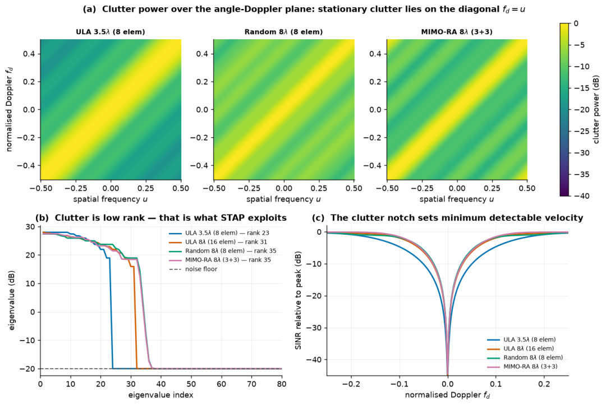
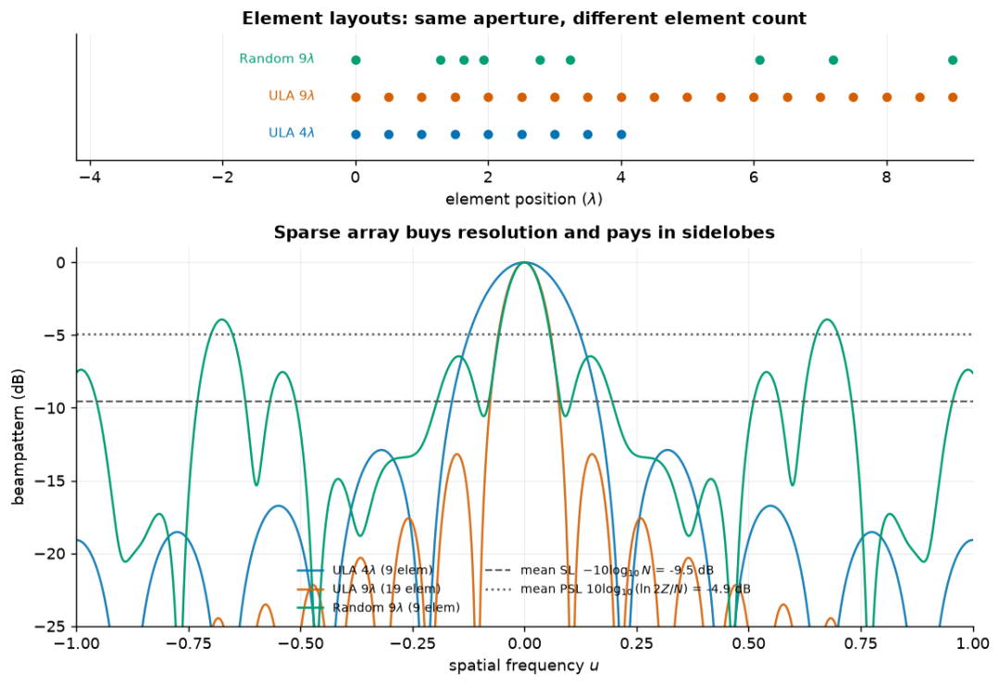
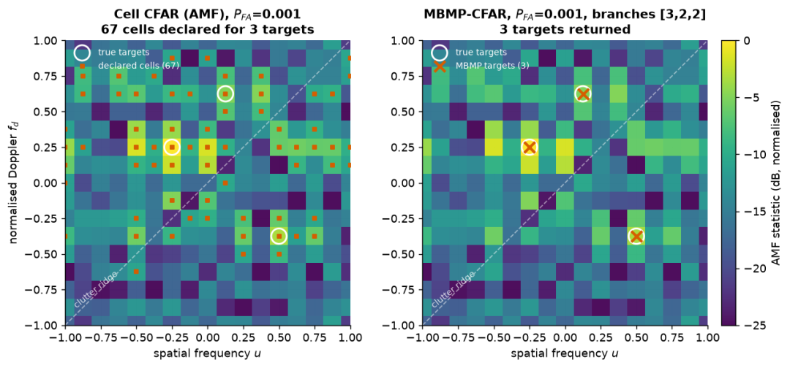
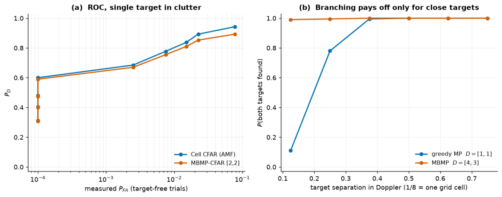
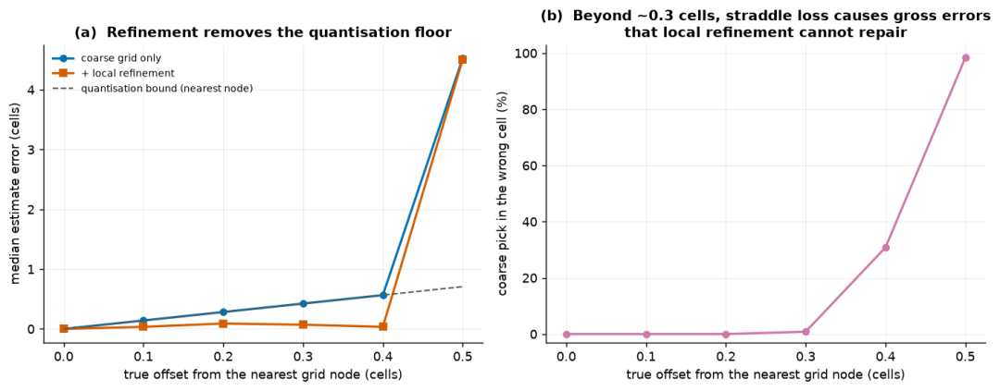
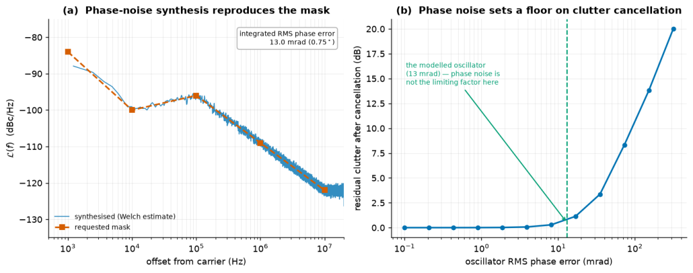

# Radar Signal Processing: 5-element array to 16-element array: Sparse Array STAP Real Test Report [with Python + MATLAB Code]

5 Elements to Match 16 Elements: Practical Report on the Sparse Array STAP
The cost of radar arrays is largely driven by the cost of the elements. Can we save on the elements? How much performance will be sacrificed, and what can the detector compensate for? Let's calculate a budget: how expensive are the elements? The real value in an antenna array isn't just the metal patches; it's the entire channel behind them—receiver, amplifier, downconversion, ADC, each step is valuable, and then there's the maintenance cost that scales similarly or even more. So, a natural question arises in engineering: can we reduce the number of elements?
Intuition might suggest that reducing the number of elements would compromise performance. However, the code provided suggests otherwise: it's possible to save money, and significantly more than you might think—provided the detector changes its approach. This paper follows the "antenna—processor—local oscillator" line, presenting experimental data to illustrate the point.
A quick review of STAP's time-space adaptive processing (STAP) capabilities: it can handle clutter by leveraging a physical fact: ground station static clutter doesn't spread evenly across the "angle—Doppler" plane but concentrates along the diagonal line fd = u (normalized coordinates, where the clutter peak is the 45° line). Since clutter is low-dimensional and has a low-rank covariance matrix, Brennan's criterion gives us an approximate clutter rank of N+(P−1)β for ULA. Low rank means that STAP can eliminate clutter with limited adaptive degrees of freedom.
The trade-off is a valley: after eliminating clutter, a deep valley remains on the Doppler axis, making slow targets fall into it and not recoverable. The narrower the valley, the lower the minimum detectable velocity, which is a hard metric for evaluating array geometry. The middle figure in the clutter peak plot and the SINR valley curve at the right side are the starting point of the entire story.
Clutter Peak, Spectral Features, and SINR Valley
Conclusion 1: Array elements can be saved, but sidelobes will rise. For the same 8λ aperture and four different array configurations, simulations show significant differences in the width of the notch (Table 1). Random arrays and MIMO random arrays spread the elements across the entire aperture, narrowing the main lobe and narrowing the notch; the downside is that the sidelobes are raised. Note the last row: for a 3-transmit-3-receive MIMO array, there are only 5 physical elements, but virtually 9, making the notch width identical to an ULA with 16 elements—0.150. The ratio of 5 to 16 is one number that readers should remember from this article.
Table 1: Cross-correlation suppression capability under 16 pulses for four array configurations at 8λ aperture (ULA 3.5λ (8 units), ULA 8λ (16 units), Random 8λ (8 units), MIMO-RA 8λ (3 transmits and 3 receives))
Array  
Physical elements  
Virtual elements  
Cross-correlation rank  
−3 dB notch width  
ULA 3.5λ (8 units)  
8  
8  
23  
0.255  
ULA 8λ (16 units)  
16  
16  
31  
0.160  
Random 8λ (8 units)  
8  
8  
35  
0.150  
MIMO-RA 8λ (3 transmits and 3 receives) 59  
35  
0.150  
Of course, saving money comes at a cost. The sidelobes of sparse arrays have a predictable pattern: the average sidelobe level is approximately −10log₁₀N, while the peak sidelobe level is approximately 10log₁₀(ln2Z/N). With fewer elements, the sidelobes rise, essentially shifting the problem from the "physical structure" of the antenna to the "signal processing" of the detector—the bright spots on the sidelobes need to be discerned by the detector as real targets or shadows of strong targets. So, the next question becomes: how does the detector tackle this messy situation?
Array geometry and pattern
Conclusion 2: The detector should use a "tree" approach, not rely solely on "thresholds" for unit-by-unit CFAR detection. The most straightforward method to detect targets is through unit-by-unit AMF/CFAR: each angle—does an independent test for each Doppler cell, declaring a target if it exceeds the threshold. It doesn't know that a strong target's sidelobes can light up dozens of cells. In the demo, there are three real targets with intensity differences of 6 dB; Cell CFAR declared 67 cells—3 true and 64 false. By raising the threshold to suppress false targets, weaker targets are discarded first. Thresholded images turn into clusters of bright spots that need manual clustering.
MBMP: Once found, it removes it, then looks for the next MBMP. This approach is completely different from finding one target and projecting it out of the residuals before looking for the next one. The sidelobes of the target disappear before the next search round. It adds a key action to traditional matching pursuit—multi-branch tree search: The branch vector D=[3,2] means retaining the top 3 most likely candidates in the first round, expanding 2 secondary candidates for each candidate, totaling 6 branches, and finally leaving the residual smallest branch. If D=[1,1,1], it degenerates back to greedy matching pursuit. The stopping condition is not preset target count but a CFAR check—stopping when the residual is as small as pure noise. In the same scene, MBMP returns exactly 3 targets.
Comparison between MBMP and Unit-by-Unit CFAR
Branching Ultimately Buys What: A Costly Close-Up of Branching - Each D times the amount of search. It only recovers in one scenario: when two targets are close enough for the greedy algorithm's first choice to be biased by the energy of a neighbor. This boundary was mapped out using Monte Carlo simulation (Table 2): At Doppler intervals of 1 grid cell (just 8 pulses away from the Doppler resolution limit), the probability that both greedy MP targets are found is only 0.11, while branching [4,3] achieves 0.99. When separated by more than 3 cells, both are at 1.0 - branching is purely a waste of computation. This boundary is worth noting: it only makes sense to spend D times the computation when the targets are "face-to-face".
Table 2: Probability of Both Near-by Targets Being Found (200 trials/point)
Doppler Interval  
Greedy MP D=[1,1]  
MBMP D=[4,3]  
1 Cell (Resolution Limit)  
0.11  
0.992  
2 Cells  
0.78  
1.00  
≥3 Cells  
1.00  
1.00  
It needs to be honest about one thing: on an individual isolated target, MBMP has a slightly lower ROC than CFAR with single-cell stopping tests. This is due to design choices - the efficacy of a sequence stop test is weaker than a clean threshold test once. Its value lies in multi-target scenarios: pushing 67 false alarms back to 3, separating face-to-face targets instead of maintaining single-target sensitivity. The paper [1] theoretically proves that the recovery condition (MB-coherence) of MBMP is much more lenient than traditional coherence conditions, allowing high dictionary coherence even when the sidelobes are raised - precisely what sparse arrays need after sidelobe elevation.
ROC and Benefit of Branching
Conclusion Three: The target does not lie exactly on the grid, and local refinement is more cost-effective than global encryption. Real targets rarely perfectly align with grid nodes. When crossing two cells, the target energy is split, resulting in a maximum loss of about 3.9 dB in matching filtering, and estimation accuracy can only reach half a cell—this is the classic straddle loss.
The simplest solution is to apply full grid encryption: the cost in two-dimensional search increases quadratically with grid density, and the denser the dictionary, the stronger the inter-column correlation, making matching pursuit less reliable. Code switched to a different approach: first search over a coarse grid, then rebuild a fine dictionary around each detection point within ±1 units from the center, resolving the problem. Cost only grows with the number of targets, not with the search space area. Results: Median estimation error reduced from 0.283 cells to 0.065 cells, precision increased by 4.3 times.
This method also has its limits, as experiments have shown: when the target offset exceeds about 0.3 cells, cross-cell losses drop the true peak by about 8 dB, and sidelobes from other cells outweigh it, leading to incorrect coarse search choices; while local refinement only searches within ±1 cells, unable to recover a wrongly chosen location. Therefore, "reliable coarse selection" is an implicit premise for this method, and in engineering applications, it's essential to measure the reliability of the coarse grid before using it.
Localization with Grid Targets and Local Refinement
The final piece of the puzzle: phase noise, which is all about signal processing on hardware's floor. STAP (Synthetic Aperture Technique) requires coherence for clutter suppression, but oscillator phase noise disrupts coherence itself—each pulse's phase jitters slightly, causing clutter echoes to be misaligned between pulses, broadening clutter peaks, increasing the rank of covariance, and filling in the nulls in the cancellation. This means that no matter how well adaptive processing is done, there is a hardware-determined floor to the depth of cancellation.
The simulation provided very specific numbers: 1 GHz carrier frequency, integral RMS phase error of 13 mrad (a very common SSB mask in engineering), with phase noise cost less than 1 dB, not a bottleneck; the degradation starts to become serious when the RMS error exceeds about 30 mrad. This threshold is exactly what system designers need to say: how good is the local oscillator, and then the phase noise becomes no longer a limiting factor. The answer lies below 13 mrad, stuck around 30 mrad.
Limits on Phase Noise Cancellation
Several reminders from the engineering process worth mentioning during the code conversion. Firstly, there are 35 .m files in the original MATLAB repository, many of which are nearly duplicate scripts that were only modified by changing scanning parameters and copied into parameterized functions. Secondly, there was a bug in the original off_grid.m—it used linear index to write "matched" markers into two columns of arrays, causing an estimation to be matched to two true values points, overestimating detection probability. The Python version has been modified to mark lines instead of individual estimates, with each estimate being consumed only once. Additionally, the training data in the simulation (secondary data) and the clutter of the detected units are distributed similarly, which is optimistic; real training data is heterogeneous, and that's usually where the real bottleneck for adaptive detection comes in in practice.
Returning to the initial question: can elements be saved? Yes, they can. A random MIMO array with 5 physical elements, similar to the ULA with 16 elements, has a clutter notch as narrow as it does. The savings go partly to more intelligent detectors—MBMP swapped branches for a 0.99 target face resolution; another part goes to finer local grids—off-network target precision increased by more than fourfold. But there is a ceiling to saving: phase noise of the local oscillator starts eating into cancellation depth after 30 mrad. Every aspect of a radar system's performance ultimately results from a negotiation among antennas, processors, and local oscillators. Those who want to verify these conclusions can run all six demos in the repository with just one command.
References  
[1] Rossi M, Haimovich A M, Eldar Y C. Multi-Branch Matching Pursuit with Applications to MIMO Radar[J]. arXiv:1312.5765, 2013 (submitted to IEEE Trans. Signal Processing).

## Images

<!-- PAYMENT_BLOCK -->

## Get this dataset

- Payment link (Stripe): [Buy now](https://buy.stripe.com/3cs8yP7sY87d0vu9AB)
- Payment QR code: 

<!-- /PAYMENT_BLOCK -->
